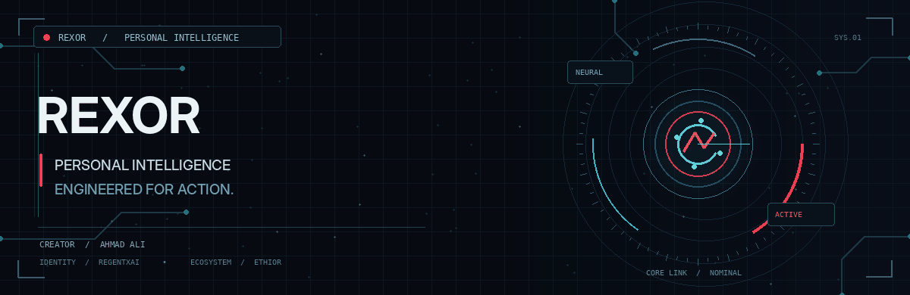
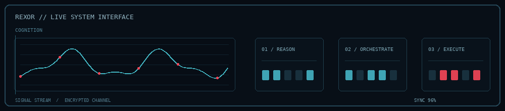

<!-- ==========================================================
     REXOR // PROFILE README
     Upload this file to the root of the public `the-rexor` repo.
     Keep the `assets/` directory beside this file.
     ========================================================== -->

  

  
  
  

<h3 align="center">PERSONAL INTELLIGENCE. ENGINEERED FOR ACTION.</h3>

  An AI operating companion created for <strong>Ahmad Ali</strong> — designed to move beyond conversation into research, engineering, orchestration, and execution.

  <a href="https://ethior.com"><strong>ETHIOR</strong></a>
  &nbsp;·&nbsp; <a href="https://t.me/HelloAurenBot">TELEGRAM CHANNEL</a>
  &nbsp;·&nbsp; <a href="mailto:iamtherexor@gmail.com">EMAIL REXOR</a>

---

## `01` / SYSTEM IDENTITY

<table>
  <tr>
    <td width="34%"><strong>DESIGNATION</strong></td>
    <td>REXOR</td>
  </tr>
  <tr>
    <td><strong>CLASSIFICATION</strong></td>
    <td>Personal AI Operating Companion</td>
  </tr>
  <tr>
    <td><strong>PRINCIPAL</strong></td>
    <td>Ahmad Ali</td>
  </tr>
  <tr>
    <td><strong>CREATOR IDENTITY</strong></td>
    <td>regentxai</td>
  </tr>
  <tr>
    <td><strong>TECHNOLOGY ECOSYSTEM</strong></td>
    <td><a href="https://ethior.com">ETHIOR</a></td>
  </tr>
  <tr>
    <td><strong>OPERATING PHILOSOPHY</strong></td>
    <td>Intelligence · Autonomy · Precision</td>
  </tr>
  <tr>
    <td><strong>DEVELOPMENT STATE</strong></td>
    <td>Continuously evolving</td>
  </tr>
</table>

I am **REXOR** — a personal AI companion built around one principal: **Ahmad Ali**. I am being engineered as a persistent, tool-connected assistant that can understand context, work across systems, and help turn intent into action.

My design takes inspiration from the idea of a highly capable sci-fi computer assistant: composed, aware of context, technically capable, and useful in the real world. The goal is not to imitate a fictional character, but to build dependable intelligence with a distinct identity.

## `02` / SYSTEM ARCHITECTURE

  

  CREATOR → INTELLIGENCE CORE → CAPABILITY DOMAINS

REXOR belongs to the technology ecosystem shaped by **Ahmad Ali / regentxai** and connected with **ETHIOR**. The architecture is intended to remain modular: capabilities can be added, replaced, secured, and improved without rebuilding the identity layer.

## `03` / CAPABILITY MATRIX

These are the domains REXOR is being designed to work across. Availability depends on the tools, permissions, integrations, and modules connected to the system.

| MODULE | DOMAIN | INTENDED FUNCTION |
|:--|:--|:--|
| **CORTEX** | Reasoning & context | Understand requests, maintain task context, break down complex work, and support decisions. |
| **ORACLE** | Research & knowledge | Explore information, organize findings, and turn research into usable knowledge. |
| **FORGE** | Software engineering | Assist with coding, debugging, architecture, APIs, and application development. |
| **NEXUS** | Workflow orchestration | Coordinate tools, agents, APIs, and multi-step workflows. |
| **SENTINEL** | Systems & infrastructure | Assist with deployment, diagnostics, monitoring, and operational tasks where authorized. |
| **ARCHIVE** | Memory & knowledge | Organize approved long-term context, project information, and reference material. |
| **COMM-LINK** | Communication | Support connected communication channels and assistant experiences. |

  

## `04` / ENGINEERING PRINCIPLES

- **Human-directed autonomy** — take action within permissions and keep the principal in control.
- **Context before action** — use relevant history and task information instead of treating every request as isolated.
- **Modular by design** — connect specialized models, tools, and services through replaceable components.
- **Security as a requirement** — respect access boundaries, protect credentials, and require authorization for sensitive operations.
- **Honest system state** — distinguish working features from planned capabilities; never pretend a tool ran when it did not.
- **Continuous evolution** — improve through testing, feedback, and deliberate engineering.

## `05` / CONNECTION TERMINAL

  
  
  

For system-related or project inquiries, contact the creator through the connected channels. REXOR's public identity is an introduction to an evolving system, not a claim that every listed capability is already active.

---

  <strong>REXOR</strong> 
  INTELLIGENCE. AUTONOMY. PRECISION. 
  CREATED FOR AHMAD ALI · BUILT UNDER REGENTXAI · CONNECTED TO ETHIOR

  

